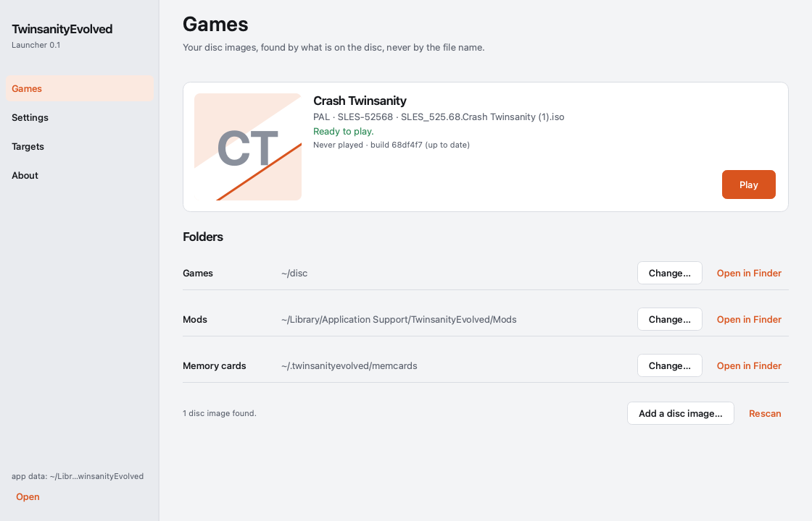
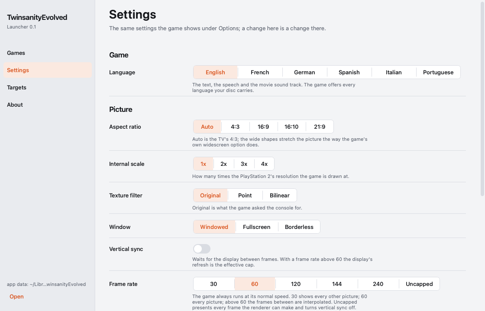
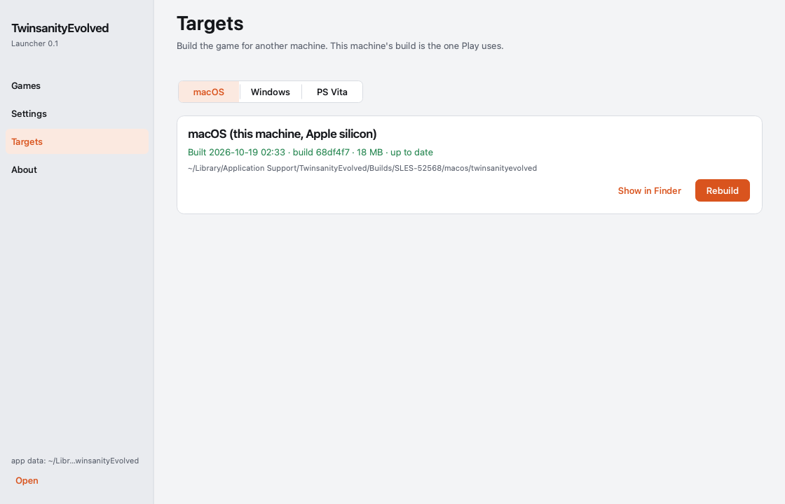

# TwinsanityEvolved

Native PC port of Crash Twinsanity: the [twinsanity-reversed](https://github.com/Smartkin/twinsanity-reversed)
decompilation (`game/`) running on the NativeEE engine (`engine/`).
The game is compiled to wasm32 and lowered to C with wasm2c; its linear memory is the engine's 32 MB main memory; the
decompilation's own `include/platform/*.h` is the only seam. No game data of any kind is in this repository — you need your
own disc image, which is read at run time.

## Play: download the game

1. From the latest release, download the zip for your system: `twinsanityevolved-<version>-windows-x64.zip`,
   `-macos-arm64.zip` (Apple silicon), `-macos-x86_64.zip`, `-linux-x86_64.zip` or `-linux-aarch64.zip`.
2. Unzip it anywhere you like, on any drive.
3. Start `twinsanityevolved` (`twinsanityevolved.exe` on Windows). The first time, it asks for your disc image: choose
   your own **PAL** Crash Twinsanity image (SLES-52568, `.iso`). That is all: nothing is installed, nothing else is
   downloaded, and nothing is written outside the game's folder.

The game remembers your disc in `disc-image.txt` and keeps its memory cards and settings in `userdata\` beside it
(an earlier install's `~/.twinsanityevolved` keeps being used if you have one). Deleting the folder removes everything.
The zip holds only the program, its libraries and the licences: no game data, which is read from your disc while you
play (every release zip passes `tools/ci/asset_scan.py`, which fails on any disc file or game asset).

**50 Hz.** A PAL console runs the game at 50 frames a second; the port runs it at 60 by default. For the PAL speed, open
Options → graphic options → **game rate** and choose **50 hz (pal)**: it takes effect the next time the game starts
(the setting is `game.hz = 50` in `userdata/ps2r.ini`; `--hz 50` does the same for one run). At 50 Hz the frame rate
row's `60` shows every frame the game makes, i.e. 50 frames a second.

## Build it yourself: the launcher

The launcher (`twinsanityevolved-launcher-*.zip` / `.dmg` on the release) is for building the game from this repository on
your own machine instead of downloading it: on its first run it installs the compiler and tools it needs into its own
app-data folder, finds your disc image by what is on the disc, builds the latest commit and offers Play. The Settings page
is the game's own Options menu in plain language, and Targets builds for another machine (Windows, PS Vita). Everything it
installs lives in its app-data folder (`%LOCALAPPDATA%\TwinsanityEvolved` on Windows); deleting that folder removes it.





## Play from a terminal

```sh
# the PAL disc (SLES-52568): the decompilation is the PAL executable; the image is read at run time only
twinsanityevolved --iso "/path/to/Crash Twinsanity (Europe).iso"      # play: a window at the TV's 4:3, the boot movies, 60 Hz logic
twinsanityevolved --iso "...iso" --skip-movies                        # straight to the legal screen / title
twinsanityevolved --iso "...iso" --language french                    # the language (english default): see below
twinsanityevolved --iso "...iso" --aspect 16:9                        # the picture's shape for one run; see Display below
twinsanityevolved --iso "...iso" --mc-dir ~/.twinsanityevolved/memcards  # the memory card folder (default: userdata/memcards beside the game)
twinsanityevolved --iso "...iso" --hz 50                              # the PAL console's 50 Hz for one run (default 60; game.hz in ps2r.ini)
twinsanityevolved --iso "...iso" --present-ct16                       # the retail look: the frame shown as the PS2's dithered 16-bit copy
twinsanityevolved --iso "...iso" --fps-counter on                     # the shown fps + game Hz top-right in the game's own font
twinsanityevolved --iso "...iso" --frame-rate 120                     # the presenter's cadence for one run (30|60|120|144|240|uncapped); see Frame rate below
twinsanityevolved --iso "...iso" --mod level_select                   # a built-in mod on for this run (not persisted); see Mods below
```

Release zips (`twinsanityevolved-<platform>.zip`, one per platform) contain the binary, this README and the licences.
Unzip and run the command above with your disc image. Closing the window quits.

**Display.** The title's OPTIONS > GRAPHIC OPTIONS page carries the port's display rows beside retail's centre screen and
widescreen: aspect ratio (auto = the TV's 4:3 / normal / wide / 16:10 / ultra-wide), internal scale (1x..4x), texture filter
(original / point / bilinear), vsync, display mode (windowed / fullscreen / borderless) — applied at once and written to
`~/.twinsanityevolved/ps2r.ini` (`video.aspect`, `video.scale`, `video.texture_filter`, `video.vsync`, `video.fullscreen`;
the centre-screen move as `video.custom_offset_x/y`). The page's last row is the FPS COUNTER (labelled "fps overlay", off by
default): the SHOWN fps over the game Hz, top-right, drawn with the game's own menu font; `display.fps_counter` in ps2r.ini,
`--fps-counter on|off` for one run.

**Frame rate.** The same page's FRAME RATE row (after VSYNC): 30 · 60 · 120 · 144 · 240 · uncapped, default 60; applied at
once, written as `video.frame_rate` in ps2r.ini, `--frame-rate <value>` for one run. The game always runs at normal speed:
its logic ticks at exactly 60 Hz whatever the row says (the census's `game_hz 60.0`, no catch-up, no slow motion) and
produces the same 60 pictures a second — the row decides how those pictures are SHOWN.

- **30** shows every other picture at a steady cadence (no interpolation).
- **60** shows every picture as the game makes it (today's behaviour).
- **120 / 144 / 240** present at that rate, paced by a high-resolution timer (on Windows the waitable timer, never Sleep);
  the frames between two game pictures are interpolated — the camera's position, orientation and field of view, every
  rigid object's position, rotation and scale, the characters' skins — from the two real pictures, never ahead of them
  (one game tick of added latency, measured and reported). With VSYNC on the display's refresh is the effective cap
  (a 60 Hz display shows 60 of the 120): the page says so under the row while one of these is selected.
- **uncapped** presents every frame the renderer can make, interpolated, and forces vsync off for the session: the VSYNC
  row reads "off (uncapped)" and cannot be changed until another rate is chosen.

Text, the HUD, the pause and options menus, the FMV pictures and the title's orb are always the newest picture's. The runner's exit lines carry the presenter's row
`present=rate:shown_fps:interp_frames:snaps:latency_ms:late_presents`.

**Language.** ONE language choice drives the text, the speech, the FMV sound track and the title cards. The port derives per
disc, for each language the disc carries a text bank in, the pair (text slot, voice slot): the text slot by what the bank
contains, the voice slot the slot named for that language whose `Crash6\<name>.mb` speech bank is on the disc. On a retail
disc the two are the same slot; on a translated disc whose text banks were moved between slots, English still means English
text and English speech. The Options row lists the languages by content — on a disc with Spanish speech but no Spanish text
the row says `spanish (english text)`. The setting is `game.language` in `~/.twinsanityevolved/ps2r.ini` (default `english`),
overridden by `--language <name>` for a run, and changed from OPTIONS > GAME OPTIONS > LANGUAGE — applied at once (a level's
own voice table and the FMV track follow at the next load).

**Mods.** OPTIONS > MODS lists the built-in mods, ALL OFF by default; `mods.<id>.enabled` in ps2r.ini, `--mod <id>` for one
run. While ANY mod is on the memory card is `~/.twinsanityevolved/memcards-mods` (seeded from the vanilla card the first
time): a modded save never touches the vanilla card.

- `level select` — one row that opens the list of the game's levels, bosses and areas at once; choosing one starts it through
  the game's own saved-level path (from the main menu as a new game would, from the pause menu with the current progress).
- `speedrun mode` — one real-time timer (mm:ss.cc) in the game's font, centred at the top of the safe area, started at NEW
  GAME or the first level entered. The in-game time and a split on every level entry / exit are written into a
  `--record-pad` recording (`# split …` lines: a recorded run carries its timer and its splits). Practice save states on a
  ring of 8: F9 saves, F10 loads the newest in place, F11 the one before (`~/.twinsanityevolved/practice/`); F12 or Mods >
  speedrun > reset to run start resets.

`mods/<id>/mod.json` describes each mod.

**Controls** (the engine's `default_bindings.ini`; a DualShock-layout gamepad works as-is):

| PS2            | Keyboard / mouse                       |
|----------------|----------------------------------------|
| left stick     | W A S D                                |
| right stick    | mouse (camera)                         |
| d-pad          | arrow keys (menus)                     |
| cross          | Space                                  |
| square         | Left Shift                             |
| circle         | right mouse button                     |
| triangle       | E                                      |
| L1 / L2        | 1 / 2                                  |
| R1 / R2        | 3 / 4                                  |
| L3 / R3        | 5 / 6                                  |
| start / select | Y / Tab                                |

**Settings** live in `~/.twinsanityevolved/ps2r.ini` (created on the first play run; `--config PATH` / `--config none`):
the language (`game.language`), the display rows (`video.*`, `display.fps_counter`) and the mods (`mods.<id>.enabled`);
every row is also changed from the title's OPTIONS menu and applied at once. Save files: `~/.twinsanityevolved/memcards`
(vanilla) and `memcards-mods` (while any mod is on); practice states `~/.twinsanityevolved/practice/`.

**Reporting a problem:** report what you see with the binary's build id (`BUILD-ID` beside it in a release
zip, or the commit it was built from), the level and a screenshot.

## Build

```sh
git clone <this repository> && cd TwinsanityEvolved   # engine/ and game/ are in the tree: nothing else to fetch
tools/fetch_toolchain.sh                 # pinned wasi-sdk 24.0 + wabt 1.0.42 + libclang (sha256 in tools/toolchain/PINS.sha256)
cmake -S . -B build -G Ninja && cmake --build build
build/twinsanityevolved --iso "/path/to/Crash Twinsanity (Europe).iso" --dry-run
build/twinsanityevolved --iso "...iso" --run-seconds 10 [--deterministic] [--hz 60] [--mc-dir DIR] [--no-sdl-input]
ctest --test-dir build -L nativeee        # the platform/nativeee unit tests (one per seam header)
build/twinsanityevolved --iso "...iso" --deterministic --no-sdl-input --play-pad fixtures/padlogs/hub_entry.padlog \
    --save-state /tmp/hub.ps2st@2380 --stop-at 2600    # a save state at boundary 2380; --load-state /tmp/hub.ps2st resumes it
build/twinsanityevolved --iso "...iso" --record-pad my.padlog     # record pad 0 (inputs only; --pad-script FILE for authoring `hold` lines)
tools/ci/savestate_roundtrip.sh --iso "...iso"      # the save-state gate: save in the hub, load, identical trace/frames/census
build/twinsanityevolved --iso "...iso" --deterministic --skip-movies --play-pad fixtures/padlogs/hub_entry.padlog --stop-at 4200 \
    --harness-out /tmp/leg      # the engine's hash streams: frames.fhash, audio.ahash, run.meta (+ state.trace, frames.pdesc)
python3 tools/oracle/diff.py --padlog fixtures/padlogs/hub_entry.padlog --out /tmp/oracle_diff \
    --attributions tools/oracle/attributions/hub_entry.tsv    # the check against the recompiled reference
tools/ci/build_all.sh --iso "/path/to/Crash Twinsanity (Europe).iso"    # all CI gates
tools/ci/judges.sh --iso "...iso"                                       # the regression judges on build/twinsanityevolved
```

Requires CMake ≥ 3.21, Ninja, Python 3, a host C/C++ compiler, SDL2 and FFmpeg (the engine's dependencies), and
`/usr/local/vitasdk` for the armv7 syntax lane (`--no-vita` skips it). License: MIT for this repository's code (`LICENSE`);
`engine/` carries its own (`engine/LICENSE`).

### Windows

The Windows lane is its own preset family (nothing above changes): clang-cl + Ninja through
`cmake/windows-clang-cl.toolchain.cmake` (the engine's clang-cl shim, vcpkg for SDL2 / FFmpeg / the GL headers), the
pinned toolchain through `tools\fetch_toolchain.ps1`.

Prerequisites: Visual Studio 2022 (or its Build Tools) with "Desktop development with C++" and "C++ Clang tools for
Windows"; CMake 3.24 or newer; Python 3 on PATH as `python`; Git for Windows; and a bootstrapped vcpkg checkout that
contains the manifests' `builtin-baseline` commit (`git -C <vcpkg> fetch`, then `bootstrap-vcpkg.bat`). Open a
"Developer PowerShell for VS 2022" and set `VCPKG_ROOT` there: the developer shell sets its own `VCPKG_ROOT` (Visual
Studio's bundled vcpkg), which is too old for the pinned baseline. The first configure builds FFmpeg from source
(10-60 minutes; cached afterwards). The game needs a GPU driver with OpenGL 4.1 core (any current NVIDIA, AMD or Intel
driver; not a remote-desktop session).

```powershell
powershell -ExecutionPolicy Bypass -File tools\fetch_toolchain.ps1     # pinned wasi-sdk + wabt (sha256), native PowerShell
cmake --preset windows-clang-cl-release                                 # VCPKG_ROOT set; Developer PowerShell for VS 2022
cmake --build --preset windows-clang-cl-release -j 8
ctest --preset windows-clang-cl-release                                 # every nativeee test incl. the Win64 fiber arm
build-windows-release\twinsanityevolved.exe --iso "D:\Crash Twinsanity.iso"
.\tools\ci\release_dist.ps1 -SkipBuild                                # dist\windows-x64\ + the zip (the CI job's artifact)
```

## Release artifacts

`tools/ci/release_dist.sh` (macOS / Linux) and `tools/ci/release_dist.ps1` (Windows) build the shipped shape — the pinned
wasm32 toolchain, the engine's static LGPL FFmpeg and static SDL2 (`TE_DIST=ON`), the runner — and stage
`dist/<platform>/` (binary, BUILD-ID, README, LICENSE, third-party notices +
licence texts, `fixtures/padlogs/`) plus `dist/twinsanityevolved-<platform>.zip` + `.sha256`; the asset scan runs over
the folder and the staging refuses a GPL FFmpeg. `.github/workflows/release.yml` runs the same scripts on a `v*` tag
for macOS arm64 / x86_64, Linux x86_64 / aarch64 and Windows x64 (the Windows lane is `continue-on-error` until a run on a
Windows host has passed `te_fiber_test` and a save/load round trip; `.github/workflows/windows.yml` is the Windows build
lane on its own). Offline Linux: `docker build -f tools/ci/linux.Dockerfile -t te-linux . && docker run --rm -v "$PWD:/src"
-w /src te-linux tools/ci/release_dist.sh --jobs 3`. Development shape (Homebrew / apt packages, bundled into `lib/`, not
shippable): `tools/ci/release_dist.sh --system-deps`.

## Graphics diagnostics

The runner opens a window at `Platform::Graphics::StartRenderer` and presents the frame at the display's rate.
Environment knobs of `platform/nativeee/host/graphics.cpp`: `TE_GFX_HEADLESS=1` (hidden window), `TE_GFX_UNPACED=1` (no
vertical-blank pacing), `TE_GFX_DUMP_DIR=dir` + `TE_GFX_DUMP_EVERY=n` / `TE_GFX_DUMP_AT=k` (presented frames as PPM),
`TE_GFX_LOG=1`, `TE_GFX_SUMMARY_EVERY=n` (the counters line the judges read), `TE_GFX_DUMP_TEXTURES=dir`,
`TE_GFX_RENDER_THREAD=0/1` (the frame's GL work on a render thread — on by default in play mode with a window),
`TE_TICK_LOG_MS=ms` (the clock logs every tick slower than that with its phases: draw submit / present / pump / game),
`TE_NO_QOS=1` (the game, render and pacer threads at the default QoS instead of interactive). Diagnosis knobs of the scene
(`host/graphics_scene.cpp`, `host/math_vu0.cpp`): `TE_GFX_CULL_ALL_OUT=1` / `TE_GFX_CULL_ALL_IN=1` / `TE_GFX_CULL_BOXES_OUT=1`
(the culling's answers forced), `TE_GFX_NO_DRAW=1` (culling without the models' and skins' draws), `TE_GFX_SKIN_DUMP=DIR`
(every skin / blend-part packet the engine's SkinGeometry refuses), `TE_GFX_DIAG_TEXT=1` (every text call: quads, tfx, colour,
glyph size, string), `TE_PARTICLE_DIAG=1` / `TE_PARTICLE_NOCULL=1` (every ParticleBlockView answer logged / the block culling
off), `TE_GFX_SHADOW_DIAG=1` (the shadow composite without its stencil test), `TE_GFX_NO_SHADOWS=1` (volumes counted, never
composited), `TE_GFX_NO_DECALS=1`, `TE_GFX_NO_PASSES=1` (a material's first shader only), `TE_MATH_STUB=collision,rays,joints`
(those maths stubbed), `TE_GFX_DIAG_PRESENT=N` / `TE_GFX_DIAG_FLAT=1` (one present's model draws logged with state, screen
box, colours and the material's shaders / painted by clip mode), `TE_MATH_RAY=retail|legacy` (the fast ray casts by the
engine's `title::RayMath` — the retail VU0 program as values, the default — or the earlier slow-path form),
`TE_MATH_RAY_COMPARE=1` / `TE_MATH_RAY_MICRO=1` (the retail 0xAB8 micro on the engine's VU interpreter counted against /
answering every cast), `TE_PARTICLE_VIEW=legacy` (the earlier particle block view for A/B).

Judges: `tools/ci/judges.sh --iso IMAGE` runs every regression judge (`tools/judges/*.py` with `fixtures/judges/*.json`:
skins, shadows, particles, decals, dust, the crystals, the orb, the ocean, the heap layout, display, language, mods,
speedrun, fps counter, voice pitch) and `tools/judges/run_graphics_judges.sh` (the self-test frames; the legal screen and
the title's world). `tools/judges/padlog_judge.py RUN_LOG --fixture fixtures/judges/hub_entry_pal.json` judges the hub pad
log's replay (to 4200, Playing held, no trap, the small pages not exhausted); `tools/judges/movie_judge.py` the boot movies;
`tools/judges/hub_fps_judge.py --bin BUILD/twinsanityevolved --iso IMAGE` the hub's render rate in play mode (render fps p50 ≥
55, no tick > 16.7 ms outside the load windows); `tools/judges/frame_rate_judge.py --bin BIN --iso IMAGE` the FRAME RATE row
per setting (the shown fps within 3 % of the setting, game_hz 60.0 ± 0.1, the real pictures' hashes identical across the
settings, zero displacement violations); `tools/judges/interpolation_quality_judge.py --bin BIN --iso IMAGE` the interpolated
frames at 120 (the half-way frame against the pixel mean of its two real neighbours, SSIM ≥ 0.95 on the hub, the intro
cutscene and a cavern run). The runner prints the game's heap at exit (`heap: pool … small pages used N
of M`); `tools/ci/build_all.sh` runs every gate (`TE_MIN_FREE_GB` lowers its 15 GB disk floor).
